<div align="center">

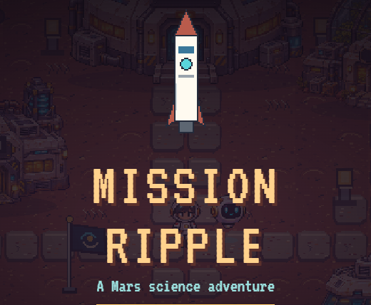

# Mission Ripple

**Every decision creates a ripple.**

A bilingual Mars science adventure for ages **7–12**. Explore a hand-crafted pixel-art outpost with Nuri, investigate authentic NASA observations, make choices across six connected missions, and watch their effects unfold across the base.

[](https://www.spaceappschallenge.org/)
[](#-scientific-sources)
[](https://phaser.io/)
[](https://www.typescriptlang.org/)
[](https://vite.dev/)
[](#-key-features)
[](#-educational-goals)

[English](README.md) · [العربية](README_AR.md)<br>
[Overview](#-overview) · [How it works](#-how-the-game-works) · [Gallery](#-gameplay-gallery) · [Science](#-scientific-sources) · [Run it](#-quick-start) · [Team](#-team-maro)

<br>

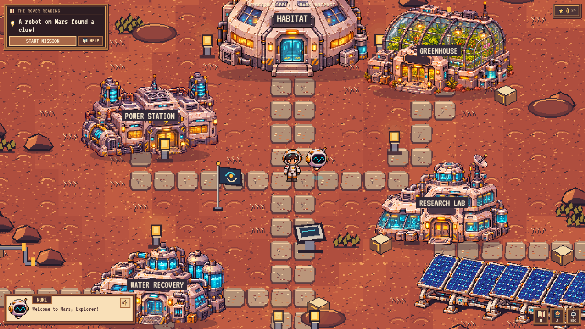

</div>

<table>
  <tr>
    <td width="33%">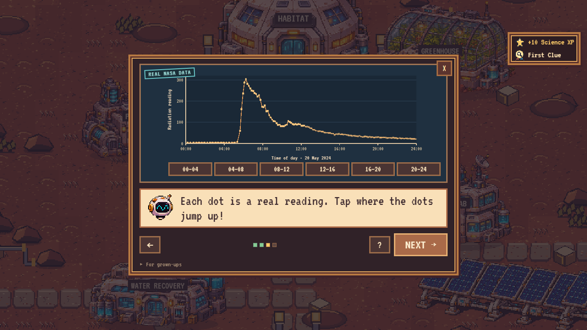<br><b>Investigate real evidence</b></td>
    <td width="33%">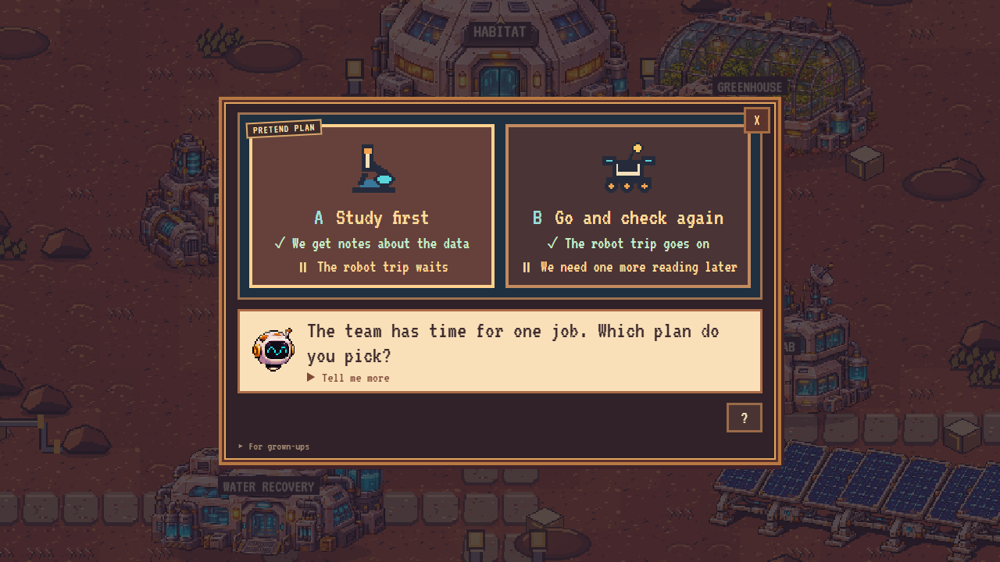<br><b>Choose a plan</b></td>
    <td width="33%">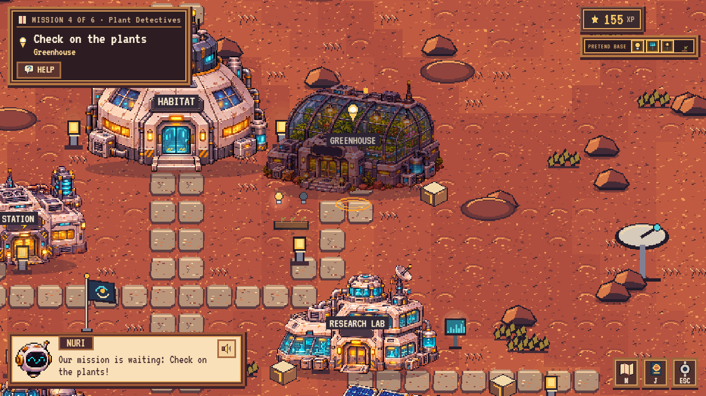<br><b>See the ripple</b></td>
  </tr>
</table>

<p align="center"><sub>Actual screenshots captured from the running game in Chrome. NASA measurements and fictional base rules are labelled separately in-game.</sub></p>

---

## 🚀 Overview

**Mission Ripple** puts a child in charge of a small Mars outpost. With **Nuri**, a friendly robot helper,
they read real measurements from NASA's **Curiosity** rover, choose a plan, and then watch that choice
**ripple** through the base over the next missions.

| | |
|---|---|
| 🎯 **Audience** | Children aged 7–12, at home or in class |
| 🌍 **Languages** | English and Arabic (full right-to-left layout) |
| 🛰️ **Data** | Real NASA records from Curiosity RAD, DONKI, OSDR and Mars Trek |
| 🎮 **Content** | 30-second cinematic intro, 6 connected missions, 3 animated endings, 64 decision paths |
| 💻 **Platform** | Runs in a modern desktop browser. No account and no sharing: progress stays on the device |

## ❓ The problem

- Children hear about space science but rarely **touch real data**. Science at school can feel like facts
  to memorize.
- Real science is full of **uncertainty**. Scientists decide what to do *before* they know every answer, and
  each choice has trade-offs.
- Most science games use invented numbers, so children can't tell **what is real** and what is make-believe.

## 💡 Our solution

A short, friendly game where real measurements are traceable to NASA records, fictional base values are labelled as game rules, and every decision matters.

1. **See real evidence.** Children explore a real radiation chart from Curiosity, recorded on Mars on
   20 May 2024.
2. **Think like a scientist.** Nuri asks simple questions: *What changed? What do we know? What is still a
   mystery?*
3. **Make a choice.** Two plans, each with a clear gain and a clear cost.
4. **See the ripple.** The choice changes the base: lamps dim, plants grow or wilt, a robot gets stuck. The
   next mission starts by showing what changed, and why.

Real and pretend are always clearly labelled. Cards marked **REAL NASA DATA** show NASA records. Cards marked
**PRETEND PLAN** show game rules.

## 🎮 How the game works

```text
 Cinematic intro ──► Explore the Mars base with Nuri ──► Mission 1: The Rover Reading
                                                                │
          ┌─────────────────────────────────────────────────────┘
          ▼
   Read real NASA data ──► Talk it through with Nuri ──► Choose plan A or B
          ▲                                                     │
          │                                                     ▼
   Next mission opens with ◄── New day: the base changes ◄── See what your choice did
   "Because you chose…"
                              … after 6 missions ──► one of 3 endings + a timeline of every decision
```

### The six missions

| # | Mission | Real evidence | The decision |
|:-:|---|---|---|
| 1 | **The Rover Reading** | Curiosity RAD readings from 19–20 May 2024 | Study the data first, or send the robot to check again |
| 2 | **Fix the Robot's Notebook** | Duplicate rows and a 121-minute gap in the RAD records | Turn on a spare monitor, or keep going and mark the gaps |
| 3 | **Sun Storm Watch** | NASA DONKI flare catalog, May 2024 | Power a Sun-watch screen, or keep doing science |
| 4 | **Plant Detectives** | NASA OSDR plant experiment OSD-615 | Keep a control tray for a fair test, or use every tray now |
| 5 | **Share the Power** | NASA Mars Trek map of Mars | Scout the route first, or take the short route now |
| 6 | **The Base Plan** | Everything learned so far | Share the plan with the next team, or pause |

### The Ripple Effect

The base runs on **3 pretend power blocks** shared by two greenhouse lamps, a spare monitor and a Sun-watch
screen. Each choice moves power around. Every new day, the plants grow or wilt, open problems stack up, and the
robot may get stuck by the rocks. Children can **recover**: relight a lamp, run a power check, or rescue the
robot. That choice decides one of three endings:

| 🌱 The base thrives | 🔧 The mission continues | 🌙 A hard day for the base |
|---|---|---|
| Healthy plants and at most one open problem | Somewhere in between | Weak plants or three or more open problems |

No path is unwinnable. A good recovery can turn any run into a thriving base.

## ✨ Key features

- 🤖 **Nuri, the robot companion.** A voiced English guide with a first-time tour, step-by-step hints,
  tips and celebrations.
- 📈 **Real-data chart.** Every dot is a real Curiosity RAD reading. Children tap where the readings jump.
- 🌊 **Visible consequences.** The world itself changes: glowing or dim greenhouse, lamp posts, a stuck rover,
  **?** bubbles on unsolved problems.
- 🎬 **Cinematic intro and three animated endings.** Each can be skipped and replayed.
- 🏅 **Science Passport.** XP, 10 badges, a list of missions and collectible discovery cards.
- 🔎 **Six hidden bonus facts** in the base's buildings.
- 🧑‍🏫 **"For grown-ups" drawer** on every science card, with exact values, units, UTC times, dataset IDs and
  the NASA link.
- 🌐 **English and Arabic.** Switch at any time with **L**.
- ♿ **Child-friendly by design.** Short sentences, one idea per screen, big buttons, reduced-motion support,
  and keyboard or touch input.

## 🎓 Educational goals

Children practise the habits of real scientists:

| Skill | Where it happens |
|---|---|
| **Reading data** | Finding the jump in a real radiation chart |
| **Comparing** | 20 May against the day before; Mars against the space station |
| **Uncertainty** | Separating what we know from what is still a mystery |
| **Data quality** | Finding duplicate rows and missing hours in a real log |
| **Fair tests** | Why a control tray matters in a plant experiment |
| **Cause and effect** | Following one decision through several days |
| **Real versus model** | Telling NASA data apart from pretend game rules |

## 📸 Gameplay gallery

All images below are **real, unedited screenshots** captured from the running game in Chrome.

<table>
  <tr>
    <td width="50%">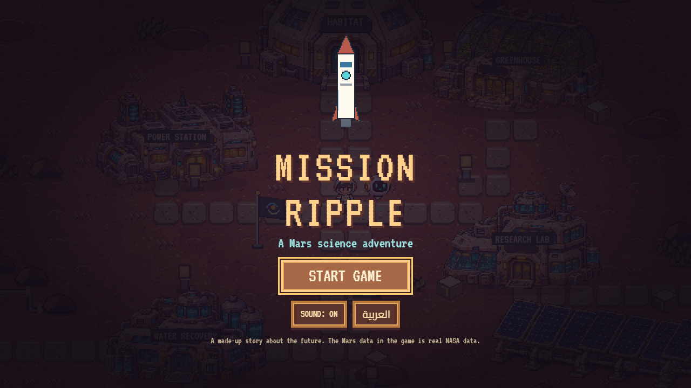<br><b>Title screen.</b> Start the adventure, switch sound or language.</td>
    <td width="50%">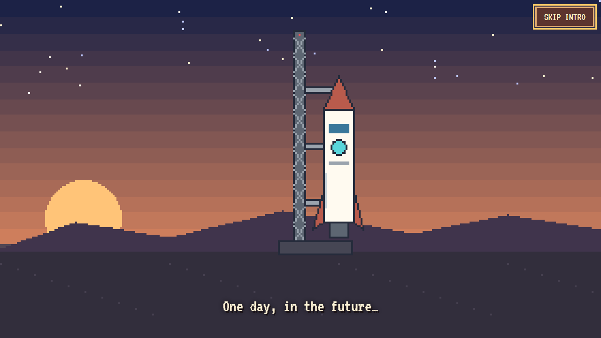<br><b>Cinematic intro.</b> A 30-second pixel-art journey from Earth to Mars.</td>
  </tr>
  <tr>
    <td>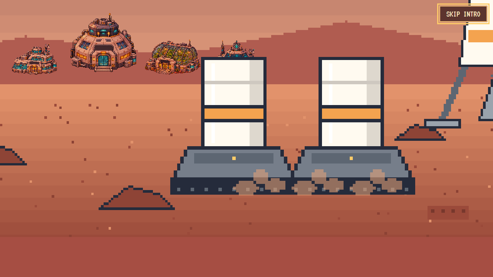<br><b>First step on Mars.</b> The outpost appears on the horizon.</td>
    <td>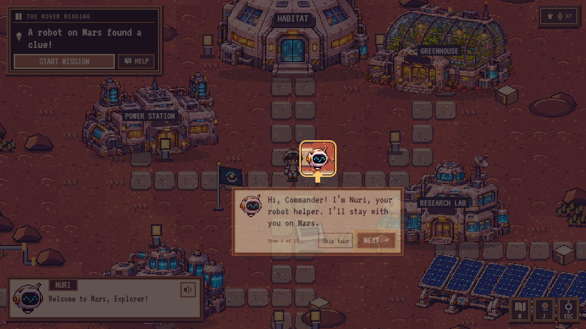<br><b>Meet Nuri.</b> A short spotlight tour shows every control.</td>
  </tr>
  <tr>
    <td>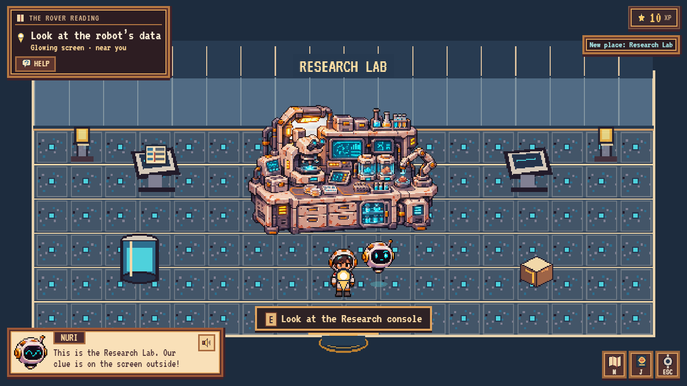<br><b>Explore the base.</b> Walk into every building. A yellow arrow guides the way.</td>
    <td><br><b>Real NASA data.</b> Curiosity's radiation readings from 20 May 2024.</td>
  </tr>
  <tr>
    <td><br><b>Make a decision.</b> Each plan has a clear gain and a clear cost.</td>
    <td>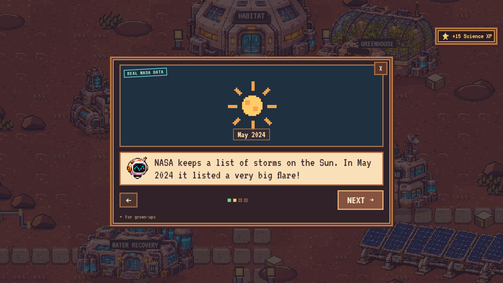<br><b>Sun Storm Watch.</b> NASA's DONKI catalog listed a very big flare in May 2024.</td>
  </tr>
  <tr>
    <td>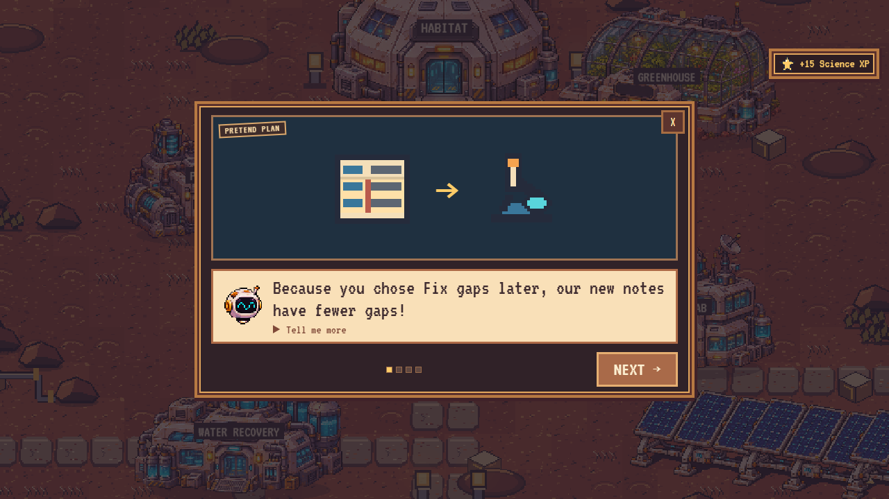<br><b>The ripple.</b> "Because you chose…" links each choice to what happens next.</td>
    <td>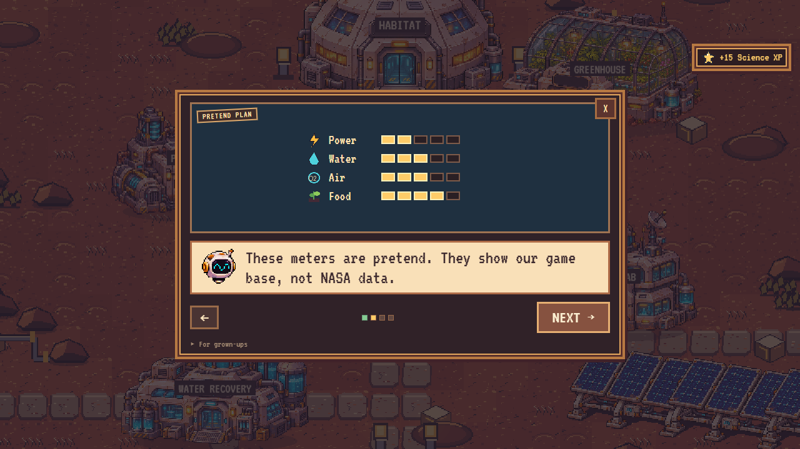<br><b>Real versus pretend.</b> The base meters are clearly labelled as game rules.</td>
  </tr>
  <tr>
    <td><br><b>The world changes.</b> One lamp lost power, so the greenhouse goes dim.</td>
    <td>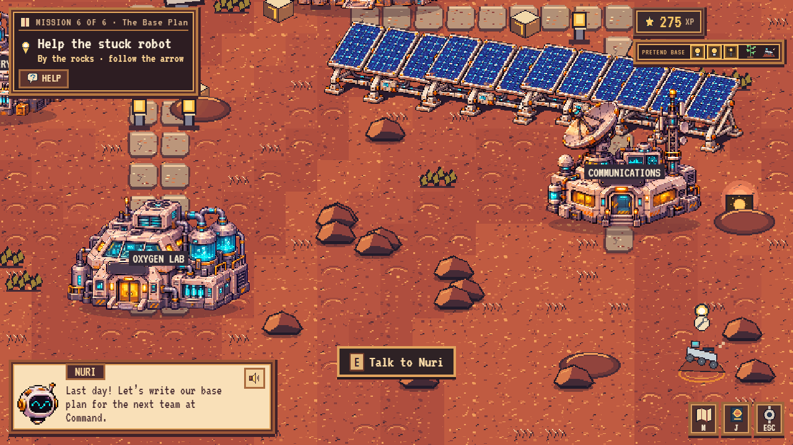<br><b>Recover from a setback.</b> A rushed route left the robot stuck by the rocks.</td>
  </tr>
  <tr>
    <td>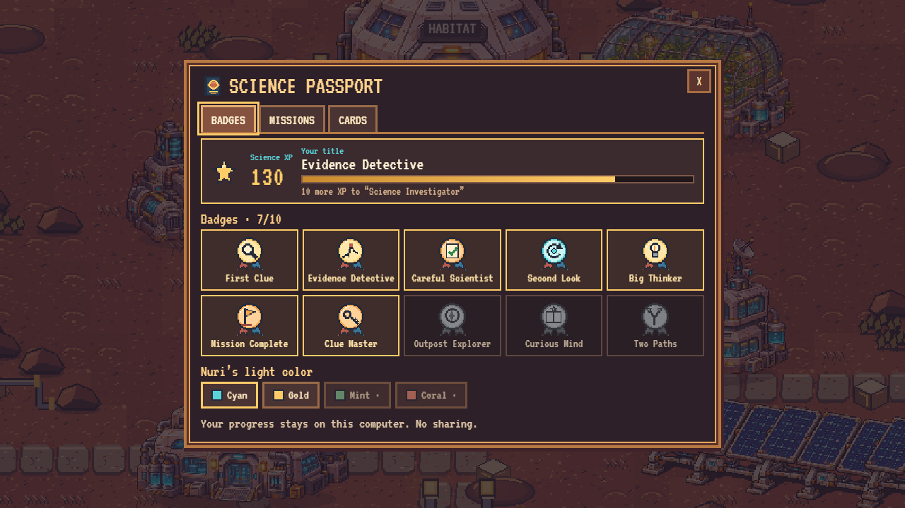<br><b>Science Passport.</b> XP, titles, badges and discovery cards.</td>
    <td>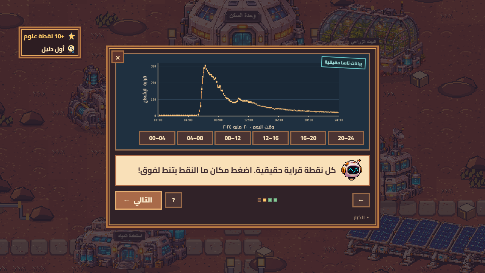<br><b>Fully bilingual.</b> The whole game in Arabic, right to left.</td>
  </tr>
</table>

### The three endings

<table>
  <tr>
    <td width="33%">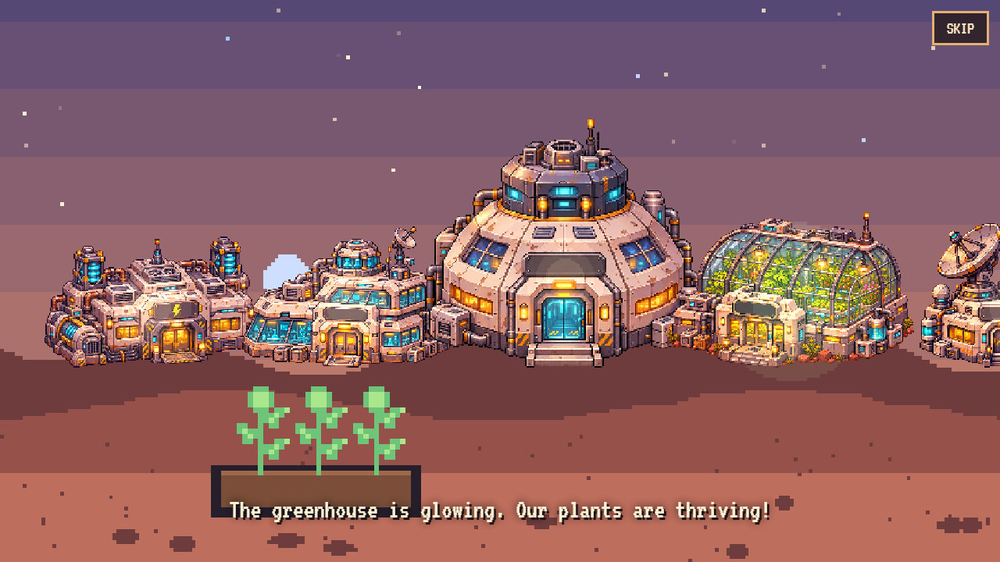<br><b>The base thrives.</b> The greenhouse glows at dusk.</td>
    <td width="33%">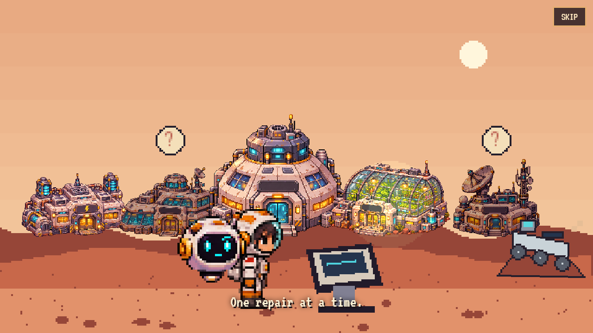<br><b>The mission continues.</b> One repair at a time.</td>
    <td width="33%">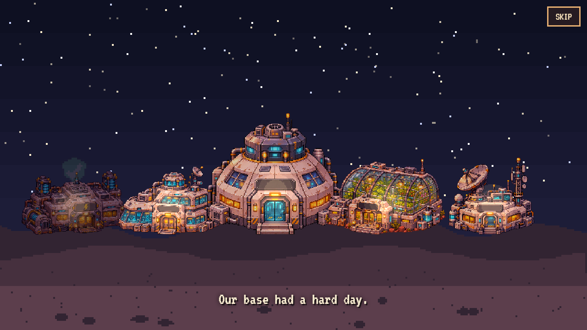<br><b>A hard day.</b> Lights stop safely, and everyone is OK.</td>
  </tr>
</table>

<p align="center">
  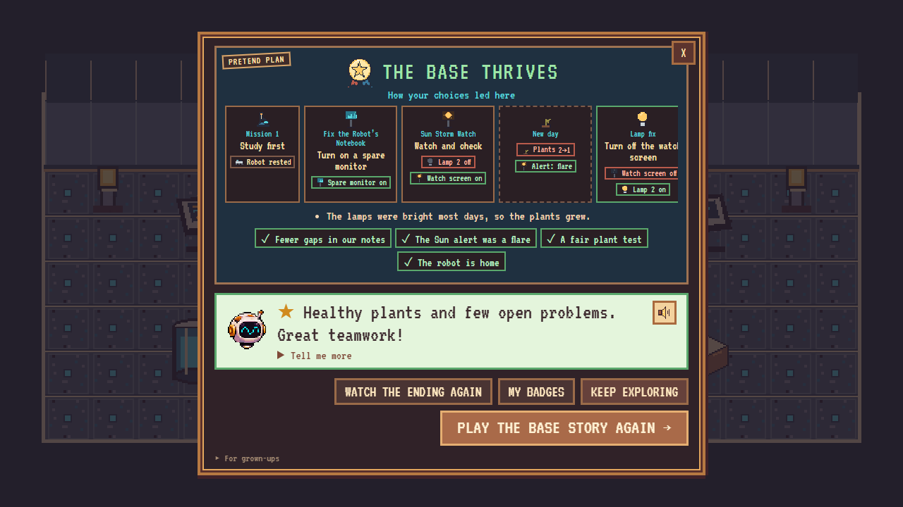<br>
  <b>The recap.</b> A timeline shows how every decision, recovery and new day led to the ending.
</p>

## 🔬 Scientific sources

All science content comes from public NASA and Canadian Space Agency sources.

| Source | Dataset | Used for | Link |
|---|---|---|---|
| **NASA RadLab** (OSDR) | `MSL-RAD-Surface`: Curiosity RAD on the surface of Mars, 2015–2024 | Mission 1 chart, Mission 2 notebook, bonus facts | [visualization.osdr.nasa.gov/radlab](https://visualization.osdr.nasa.gov/radlab/gui/data-api/) |
| **NASA RadLab** (OSDR) | `ISS-DosTel`: International Space Station, 1–7 April 2022 | "Different places, different readings" bonus fact | [visualization.osdr.nasa.gov/radlab](https://visualization.osdr.nasa.gov/radlab/gui/data-api/) |
| **NASA DONKI** (CCMC) | Space weather catalog, May 2024 | Mission 3: Sun Storm Watch | [DONKI guide](https://ccmc.gsfc.nasa.gov/DONKI/guide/) · [X8.7 flare record](https://ccmc.gsfc.nasa.gov/DONKI/view/FLR/30849/-1) |
| **NASA OSDR** | `OSD-615`: plant spaceflight experiment | Mission 4: Plant Detectives | [OSD-615 dataset](https://visualization.osdr.nasa.gov/biodata/api/v2/dataset/OSD-615/) |
| **NASA Mars Trek** | MOLA color-shaded map of Mars | Mission 5: Share the Power | [Mars Trek API](https://trek.nasa.gov/tiles/apidoc/trekAPI.html?body=mars) |
| **Canadian Space Agency** | Food Production Toolkit | Greenhouse bonus fact | [CSA toolkit](https://www.asc-csa.gc.ca/eng/youth-educators/toolkits/food-production/) |

<details>
<summary><b>Key values used in the game</b></summary>

<br>

| Fact | Value | Source |
|---|---|---|
| Highest reading, 20 May 2024 | 303.98798 µGy/hour at 06:15:19 UTC | `MSL-RAD-Surface` |
| Median reading, 19 May vs 20 May 2024 | 3.85 vs 42.50 µGy/hour | `MSL-RAD-Surface` |
| Readings above 30 µGy/hour on 20 May | 92, over about 14.4 hours | `MSL-RAD-Surface` |
| Typical surface reading, 2015–2024 | median 8.22 µGy/hour, from 274,998 readings | `MSL-RAD-Surface` |
| Conflicting same-time rows | 29 | `MSL-RAD-Surface` |
| Space weather, May 2024 | 181 flares, 144 CMEs, 14 SEP events; strongest flare X8.7 on 14 May | DONKI |
| Plant experiment design | 12 samples: 6 spaceflight, 6 ground control | OSD-615 |

</details>

**Scientific honesty rules:**

- The rover's readings are **never** shown as an astronaut's dose, a reading inside the base, or a safety limit.
  The 30 µGy/hour line is a descriptive cutoff, not a safety threshold.
- The game does **not** claim a cause for the 20 May 2024 increase. The source records don't establish one.
- Absorbed dose is never converted into dose equivalent by guessing.
- Power, water, air and food meters, XP and badges are **pretend game rules**, and every one is labelled.
- Snapshots in [`src/science/`](src/science/) keep the original values, units, UTC times and SHA-256 hashes of
  the source files, so every chart point can be traced back to the NASA record.

## ⚡ Quick start

**Requirements:** [Node.js](https://nodejs.org/) 20.19 or newer, and a modern desktop browser (tested in Google Chrome).

```bash
git clone https://github.com/kero334/mission-ripple.git
cd mission-ripple
npm install
npm run dev
```

Then open **http://localhost:5182/** and press **START GAME**.

| Command | What it does |
|---|---|
| `npm run dev` | Start the game locally at http://localhost:5182/ |
| `npm run build` | Type-check and build a production bundle into `dist/` |
| `npm run preview` | Serve the production build at http://localhost:4182/ |
| `npm test` | Unit tests: science values, rewards, hints, saves, translations, reading level and all 64 decision paths |

Run `npm test` and `npm run build` before publishing changes. Tests that compare against the full original NASA research package skip when that separate package is unavailable; the game ships its validated, source-linked science snapshots.

<details>
<summary><b>Browser QA scripts</b> (run with <code>npm run dev</code> in another terminal)</summary>

<br>

| Command | Checks |
|---|---|
| `npm run qa:experience` | Full Chrome playthroughs of Mission 1 (about 10 minutes) |
| `npm run qa:campaign` | All three endings, recovery, reload and Arabic |
| `npm run qa:intro` | The opening cinematic |
| `npm run qa:camera` | Camera framing |
| `npm run qa:science` | Every chart row against the original NASA CSV (needs the research package in a sibling folder) |
| `node tools/voice-qa.mjs` | Nuri's voice |
| `node tools/companion-qa.mjs` | Tour, tips and celebrations |
| `node tools/sfx-qa.mjs` | Sound levels |
| `node tools/responsive-qa.mjs` | Window sizes |

The QA scripts drive the installed Google Chrome through Playwright.

</details>

## 🕹️ How to play

| Key | Action |
|---|---|
| **W A S D** / **Arrow keys** | Move (hold **Shift** to run) |
| **E** | Use things and talk to Nuri |
| **H** | Nuri's help |
| **M** | Map |
| **J** | Science Passport |
| **B** | Your tools |
| **L** | Switch English / Arabic |
| **Esc** | Pause and settings |

1. Press **START GAME** and watch the intro, or skip it with **SKIP INTRO**, **Esc**, **Enter** or **Space**.
2. Follow Nuri's short tour.
3. Press **START MISSION** and follow the **yellow arrow**: the glowing screen → the Research Lab → the Command Hub
   → Communications.
4. After Mission 1, press **NEXT MISSION** to start the five-mission base story.
5. Reach an ending, read the recap, then play again to try other choices.

A saved game offers **CONTINUE**. **Settings** has *Replay cinematic*, *Replay tour*, sound and voice controls.

## 🧱 Built with

| Layer | Technology |
|---|---|
| Game engine | [Phaser 3](https://phaser.io/) (tile world, camera, sprites, cinematics) |
| Language | [TypeScript](https://www.typescriptlang.org/) |
| Build tool | [Vite](https://vite.dev/) |
| Interface | HTML and CSS overlay for cards, HUD and panels, with right-to-left support |
| Audio | Web Audio API for the procedural music and sound effects; pre-recorded voice lines for Nuri |
| Testing | Node unit tests and [Playwright](https://playwright.dev/) Chrome playthroughs |
| Fonts | [VT323](https://fonts.google.com/specimen/VT323) and [Cairo](https://fonts.google.com/specimen/Cairo), SIL Open Font License |

<details>
<summary><b>Project structure</b></summary>

```text
mission-ripple/
├── index.html              # HUD markup
├── src/
│   ├── main.ts             # HUD wiring and game start
│   ├── scene.ts            # Tile world, camera, rooms, Nuri, guidance arrow
│   ├── content/            # All child-facing text (English + Arabic), science cards
│   ├── science/            # NASA data snapshots (*.json), Mission 1 state machine, cards
│   ├── missions/           # Missions 2–6: content, engine and saves
│   ├── game/               # Pretend base rules, rewards, hints, progress
│   ├── companion/          # Nuri's tour, tips and celebrations
│   ├── intro/  ending/     # Opening cinematic and the three endings
│   ├── audio/              # Voice playback and sound effects
│   └── ui/                 # Cards, chart, passport, map, settings
├── public/assets/          # Pixel art, voice lines, manifests
├── tools/                  # Art and data builders, unit tests, Chrome QA scripts
├── docs/                   # Design and science documentation, README screenshots
└── qa-screenshots/         # Captures from automated playthroughs
```

</details>

## 📚 Documentation

| Document | Contents |
|---|---|
| [`docs/CAMPAIGN.md`](docs/CAMPAIGN.md) | Missions 2–6, the pretend base rules, how decisions connect, the endings |
| [`docs/CHILD_EXPERIENCE.md`](docs/CHILD_EXPERIENCE.md) | Learning flow, writing rules, chart, hints, rewards, saves |
| [`docs/SCIENCE_MISSION_ARCHITECTURE.md`](docs/SCIENCE_MISSION_ARCHITECTURE.md) | Science boundaries and data flow |
| [`docs/MISSION_SELECTION_AND_SCIENCE.md`](docs/MISSION_SELECTION_AND_SCIENCE.md) | Why this mission and this data were chosen |
| [`docs/CINEMATIC.md`](docs/CINEMATIC.md) | The opening cinematic |
| [`docs/VOICE_AND_COMPANION.md`](docs/VOICE_AND_COMPANION.md) · [`docs/SOUND.md`](docs/SOUND.md) | Nuri's voice, companion and sound |
| [`docs/PIXEL_ART_SPEC.md`](docs/PIXEL_ART_SPEC.md) · [`docs/WORLDBUILDING_SPEC.md`](docs/WORLDBUILDING_SPEC.md) | Art and world rules |
| [`docs/CHILD_TESTING_PROTOCOL.md`](docs/CHILD_TESTING_PROTOCOL.md) | Plan for testing with first-time players |
| [`docs/UNFINISHED.md`](docs/UNFINISHED.md) | Known gaps |

**Status:** all features above are built and covered by automated tests. Testing with children, a science review of
the wording, and tuning of the pretend rules are the next steps.

## 👥 Team MARO

<div align="center">

**Mission Ripple** was created by **Team MARO** for the **NASA Space Apps Challenge, Cairo 2026**.

*We believe every child can think like a scientist, one decision at a time.*

</div>

## 🙏 Acknowledgements

- **NASA** for open access to RadLab, OSDR, DONKI and Mars Trek data.
- The **Canadian Space Agency** for its Food Production education toolkit.
- The authors of the **VT323** and **Cairo** fonts.

<div align="center">
<sub>Mission Ripple is a made-up story about the future. The Mars data in the game is real NASA data.<br>
This project is not affiliated with or endorsed by NASA.</sub>
</div>
