<div align="center">

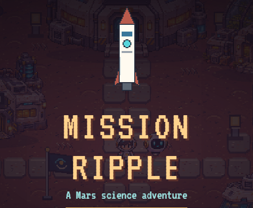

# Mission Ripple — مهمة ريبل

**كل قرار يصنع أثرًا.**

مغامرة علمية ثنائية اللغة على المريخ للأطفال من **7 إلى 12 سنة**. يستكشف اللاعب قاعدة مرسومة بفن البكسل مع نوري، يقرأ مشاهدات حقيقية من ناسا، ويتخذ قرارات تظهر آثارها في المهمات التالية.

[العربية](README_AR.md) · [English](README.md) · [ابدأ اللعب](#-تشغيل-اللعبة) · [الصور](#-صور-من-اللعبة)

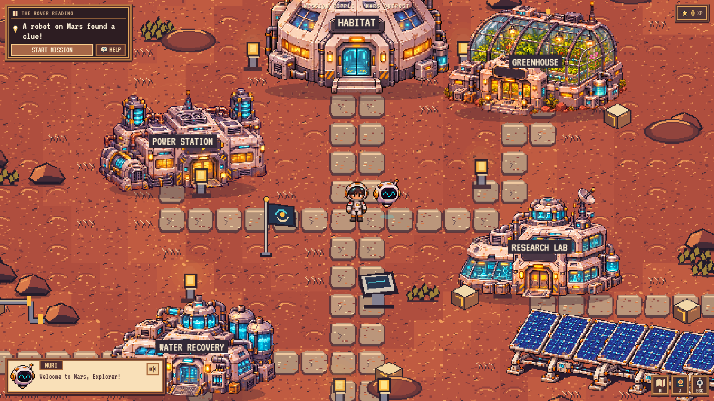

</div>

## 🎮 الفكرة

يتحرك رائد فضاء صغير داخل قاعدة مترابطة على المريخ. تساعده **نوري** على طرح الأسئلة الصحيحة: ماذا قاست ناسا؟ ماذا نعرف؟ وماذا لا نعرف بعد؟ ثم يختار خطة ويرى أثرها المباشر واللاحق، وقد تتاح له فرصة للتعافي من نتيجة صعبة.

اللعبة تضم **ست مهمات مترابطة**، ونظام قرارات يؤثر في القاعدة، وثلاث نهايات متحركة. يمكن اللعب بالإنجليزية أو العربية مع واجهة تدعم اتجاه الكتابة من اليمين إلى اليسار.

| ما هو حقيقي؟ | ما هو محاكاة تعليمية؟ |
|---|---|
| قراءات عربة **Curiosity** وبيانات ناسا المرتبطة بمصادرها | القاعدة، الطاقة، نمو النباتات، نقاط الخبرة، ونتائج قرارات اللاعب |

لا تحوّل اللعبة قراءة عربة المريخ إلى جرعة رائد فضاء أو حد سلامة للبشر، ولا تنسب لناسا نتائج أنظمة القاعدة الخيالية.

## 📸 صور من اللعبة

كل الصور التالية مأخوذة من تشغيل اللعبة الفعلي في Chrome.

| استكشف الدليل | اتخذ قرارًا | شاهد النتيجة |
|---|---|---|
| 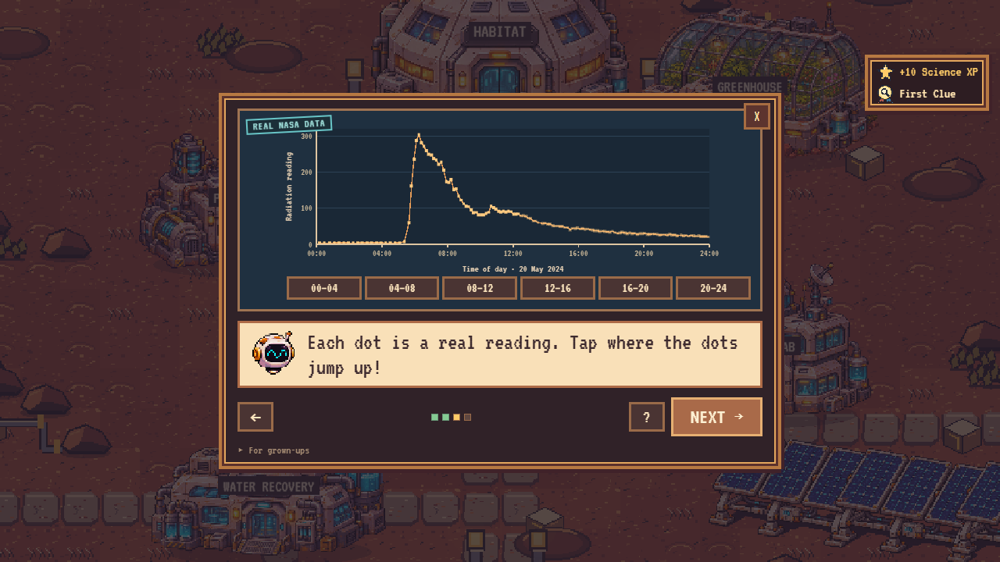 | 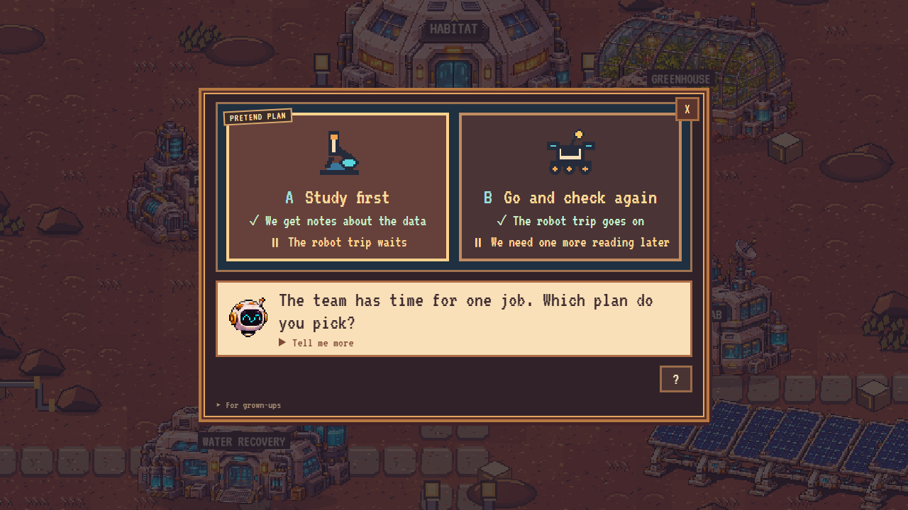 | 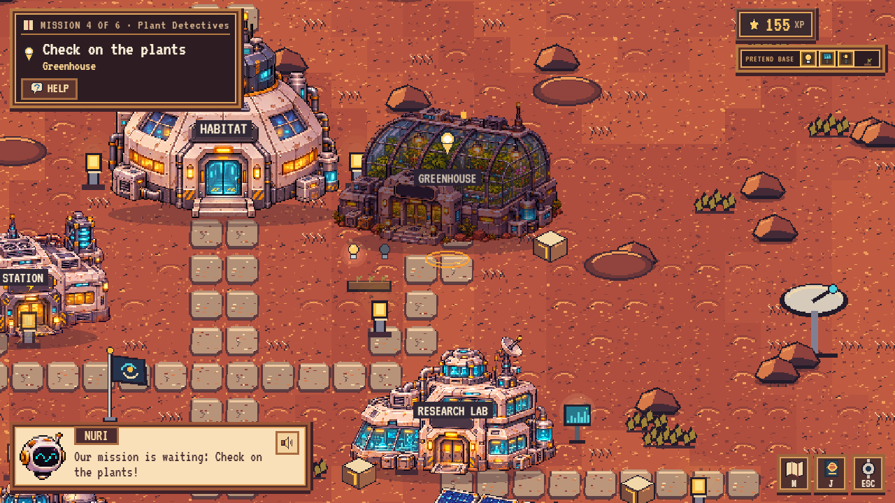 |

| نوري ومقدمة الرحلة | جواز العلوم | واجهة عربية |
|---|---|---|
| 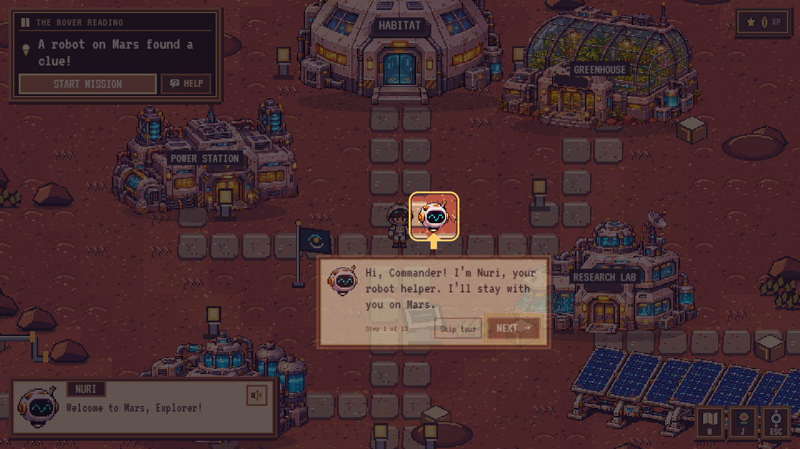 | 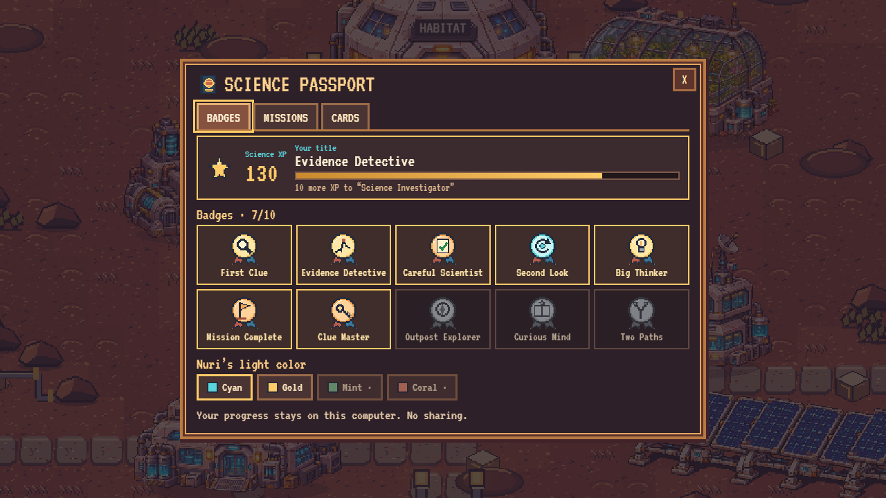 | 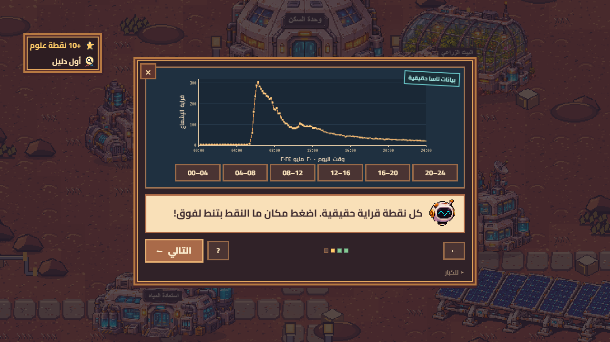 |

### النهايات الثلاث

| القاعدة تزدهر | المهمة مستمرة | يوم صعب للقاعدة |
|---|---|---|
| 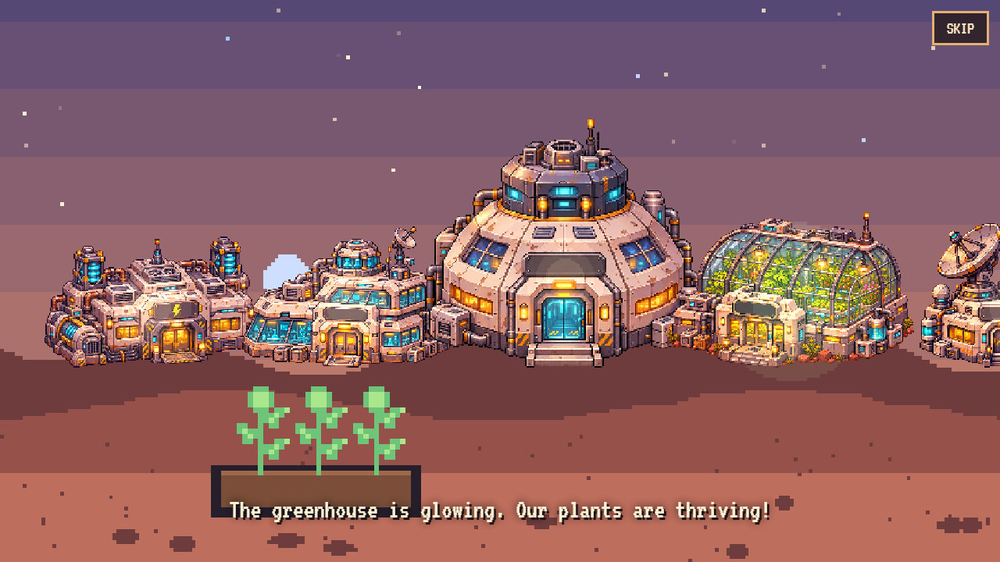 | 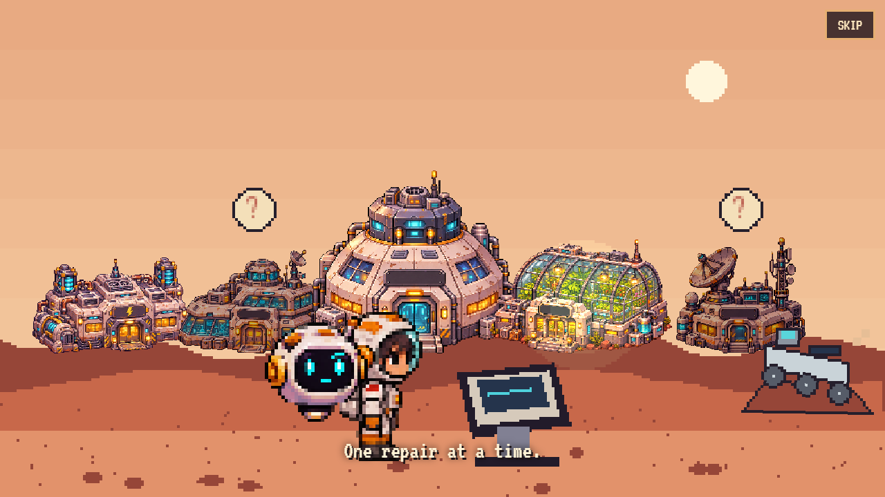 | 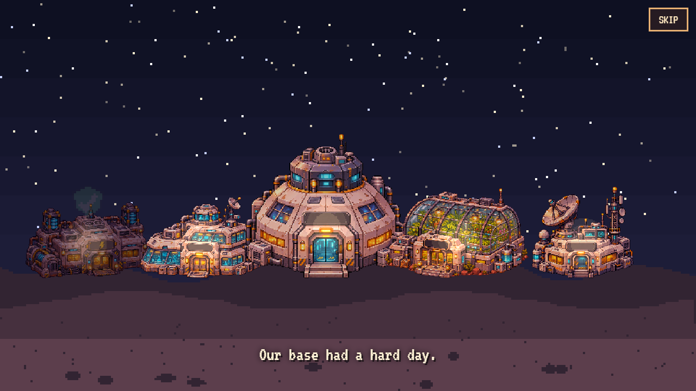 |

## 🚀 تشغيل اللعبة

تحتاج إلى Node.js متوافق مع Vite 8 ومتصفح حديث. من الطرفية:

```bash
git clone https://github.com/kero334/mission-ripple.git
cd mission-ripple
npm ci
npm run dev
```

افتح `http://localhost:5182/` واضغط **START GAME**. استخدم **WASD** أو الأسهم للحركة، **E** للتفاعل، **H** لمساعدة نوري، **J** لجواز العلوم، و**L** لتغيير اللغة.

للتأكد من المشروع:

```bash
npm test
npm run build
```

شغّل الاختبارات وبناء المشروع قبل نشر أي تغيير. اختبارات المقارنة مع ملفات ناسا الخام تحتاج حزمة البحث المنفصلة؛ اللعبة نفسها تتضمن نسخ البيانات العلمية المستخدمة فيها.

## 🔬 المصادر والتقنية

تعتمد المشاهدات العلمية على بيانات [NASA RadLab](https://visualization.osdr.nasa.gov/radlab/gui/data-api/)، و[DONKI](https://ccmc.gsfc.nasa.gov/DONKI/guide/)، و[OSDR](https://osdr.nasa.gov/)، و[Mars Trek](https://trek.nasa.gov/mars/)، مع مواد تعليمية من [وكالة الفضاء الكندية](https://www.asc-csa.gc.ca/eng/youth-educators/toolkits/food-production/). التفاصيل العلمية والقيود موثقة في [README الإنجليزي](README.md#-scientific-sources) وملفات `docs/`.

بُنيت اللعبة باستخدام **Phaser 3 وTypeScript وVite**. أنشأها **Team MARO** ضمن NASA Space Apps Cairo 2026. المشروع لا يمثل ناسا ولا يحظى بتأييد رسمي منها.
